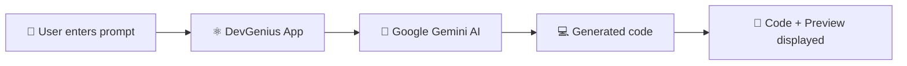

**DevGenius** is an AI-powered code generator that turns plain English prompts into working code.

Type what you want, and get the code with a live preview in seconds.

Built with **React**, **Vite**, **JavaScript**, **CSS**, **Tailwind CSS**

[🚀 **Live Demo**](YOUR_LIVE_LINK_HERE) 


## 📑 Table of Contents

- [🎯 Problem & Solution](#-problem--solution)
- [✨ Features](#-features)
- [⚙️ How It Works](#️-how-it-works)
- [🛠️ Tech Stack](#️-tech-stack)
- [🧩 Skills Demonstrated](#-skills-demonstrated)
- [🚀 Getting Started](#-getting-started)
- [📂 Project Structure](#-project-structure)
- [🔮 Roadmap](#-roadmap)
- [👨‍💻 About Me](#-about-me)

---

## 🎯 Problem & Solution

| ❌ The Problem | ✅ The Solution |
|---|---|
| Beginners and busy developers waste time searching for syntax, snippets and boilerplate. | **DevGenius** turns a simple English description into working code. |
| Writing a precise technical query is often harder than the code itself. | No technical wording needed. Just say what you want. |
| Hard to know if the code is right until you run it. | Code and **live preview** are shown together, so you see results instantly. |

---

## ✨ Features

| | Feature | Description |
|---|---|---|
| 💬 | **Plain-English Prompts** | Describe what you need, no jargon required |
| 👀 | **Code + Preview** | See the generated code and its result in one view |
| 🎨 | **Clean Modern UI** | Built with Tailwind CSS for a polished look |
| 📱 | **Responsive Design** | Adapts to different screen sizes |
| ⚡ | **Fast Experience** | Built with React and Vite for quick loading and updates |

---

## ⚙️ How It Works



1. **Enter a prompt** describing the code you want.
2. The app **sends your prompt to Google Gemini**.
3. The AI **generates the code**.
4. The app **shows the code and a preview**.

---

## 🛠️ Tech Stack

| Layer | Technology |
|-------|-----------|
| **Frontend** | React.js, JavaScript (ES6), HTML5 |
| **Build Tool** | Vite |
| **Styling** | Tailwind CSS |
| **AI** | Google Gemini |
| **Version Control** | Git & GitHub |

---

## 🧩 Skills Demonstrated

- ⚛️ **React fundamentals:** component-based architecture, state and props
- 🔄 **State handling:** loading, success and error states for a smooth user experience
- 🤖 **AI integration:** bringing generative AI into a real web app
- 📱 **Responsive UI:** mobile-friendly layouts with Tailwind CSS
- ⚡ **Modern tooling:** fast development workflow with Vite
- 🧹 **Clean code:** organized, readable project structure

---

## 🚀 Getting Started

### Prerequisites
- [Node.js](https://nodejs.org/) (v18 or later)

### Installation

**1️⃣ Clone the repository**
```bash
git clone https://github.com/Abhishek-Singh-techno/DevGenius-AI-Code-Generator.git
cd DevGenius-AI-Code-Generator
```

**2️⃣ Install dependencies**
```bash
npm install
```

**3️⃣ Add your Gemini key**

Create a `.env` file in the project root and add:
```env
VITE_GEMINI_API_KEY=your_key_here
```

**4️⃣ Run the app**
```bash
npm run dev
```
Open the local URL shown in your terminal (usually `http://localhost:5173`).

---

## 📂 Project Structure

```
DevGenius-AI-Code-Generator/
├── public/
├── src/
│   ├── assets/
│   ├── AiCodeGenerator.jsx   # main AI code generator component
│   ├── App.css
│   ├── App.jsx
│   ├── index.css
│   └── main.jsx
├── .gitignore
├── eslint.config.js
├── index.html
├── package-lock.json
├── package.json
├── README.md
└── vite.config.js
```

## 👨‍💻 About Me

Hi, I'm **Abhishek Singh** 👋, Full stack developer who enjoys building practical projects with React and JavaScript. I'm actively looking for **internship and  developer opportunities** and I'm always learning.


[](mailto:abhishekvishen08@gmail.com)
[](https://www.linkedin.com/in/abhishek-singh-307162306/)
[](https://github.com/Abhishek-Singh-techno)


